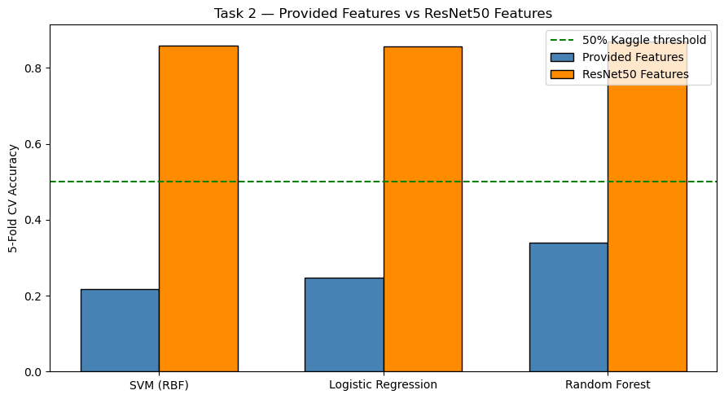
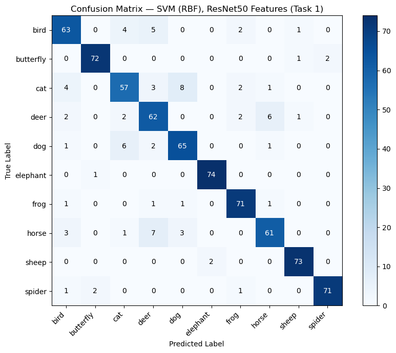

# Image Classification: Hand-Crafted Features vs Pretrained ResNet50

**Question:** How far can classic image features take a classifier, and what changes when the task goes from "dog vs elephant" to "Herring Gull vs Ring-billed Gull"?

**Tools:** Python, scikit-learn (SVM, Logistic Regression, Random Forest), PyTorch / torchvision (ResNet50), pandas, matplotlib.

Two tasks, same pipeline:

| | Task 1: Animals | Task 2: Bird species |
|---|---|---|
| Data | 10 animal classes (CIFAR-10 style), 64×64 px | 10 bird species (CUB-200-2011), 128×128 px |
| Training images | 3,750 (375 per class) | 417 (about 42 per class) |
| Difficulty | Classes look very different | Near-identical pairs, tiny training set |

## Key results (5-fold cross-validation accuracy)

| Model | Animals: provided features | Animals: ResNet50 | Birds: provided features | Birds: ResNet50 |
|---|---:|---:|---:|---:|
| Zero-R baseline | 0.100 | 0.100 | 0.096 | 0.096 |
| SVM (RBF) | 0.517 | **0.893** | 0.218 | 0.859 |
| Logistic Regression | **0.536** | 0.877 | 0.247 | 0.856 |
| Random Forest | 0.500 | 0.867 | **0.341** | **0.871** |



## What I found

- **Hand-crafted features hit a ceiling fast.** Colour histograms, HOG and texture features got about 54% on animals but only about 34% on birds. Global image statistics can't see the small markings that separate one sparrow from another.
- **More features isn't always better.** On birds, the 23 "additional" texture features alone (0.293) beat all 219 features combined (0.247). With only about 42 images per class, extra features add noise faster than signal.
- **Transfer learning fixes it.** Using a ResNet50 pretrained on ImageNet as a feature extractor (2,048 features per image) pushed animals to 89% and birds to 87%. The jump is biggest on the harder task (34% to 87%).
- **The best model changes with the data.** SVM won on animals with plenty of data. Random Forest won on the small bird set. Remaining errors sit on genuinely similar pairs, like cat vs dog and the two gull species.



## Method

1. Load the provided features (96 colour histogram + 100 HOG-PCA + 23 additional) and standardise them.
2. Compare a Zero-R baseline, SVM (RBF), Logistic Regression and Random Forest with stratified 5-fold CV.
3. Feature subset analysis: which feature group carries the signal.
4. Error analysis with confusion matrices on a stratified 80/20 holdout.
5. Extract 2,048-dim ResNet50 features (ImageNet weights, no fine-tuning) and repeat the comparison.
6. Fit the best model on all training data and predict the test set (Kaggle-style submission).

| Notebook | Task |
|---|---|
| [`01_animals_cifar10.ipynb`](notebooks/01_animals_cifar10.ipynb) | Task 1, 10 animal classes |
| [`02_birds_cub200.ipynb`](notebooks/02_birds_cub200.ipynb) | Task 2, 10 bird species |

## Data

The images and pre-extracted features were provided through the course, so they aren't included here. To run the notebooks, put the data in:

```
data/task1_data/   train_metadata.csv, test_metadata.csv, feature CSVs, images/
data/task2_data/   same layout
```

The underlying images come from CIFAR-10 (Krizhevsky, 2009) and CUB-200-2011 (Wah et al., 2011), both public.

## Limitations

- ResNet50 was used as a frozen feature extractor only. Fine-tuning it would likely do better on birds, but needs a GPU.
- With about 8 validation images per bird class, per-class scores are noisy.

---

*Originally built for COMP30027 Machine Learning, University of Melbourne (2026).*
